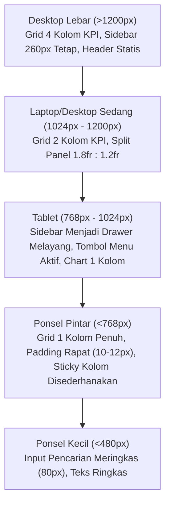

# Design System: Portal SDM Universitas Bhakti Kencana (UBK)

Dokumen ini merupakan panduan arsitektur antarmuka resmi (*Single Source of Truth*) untuk Portal Kepegawaian dan Pengelolaan Sasaran Kinerja Pegawai (SKP) Tridharma di lingkungan Universitas Bhakti Kencana. Seluruh pengembang dan perancang antarmuka wajib mematuhi standar desain berikut agar konsistensi visual, stabilitas tata letak, dan aksesibilitas sistem terjaga secara prima.

---

## 1. Identitas Institusional & Prinsip Anti-Slop

### Karakter Visual
- **Institusi**: Direktorat Sumber Daya Manusia, Universitas Bhakti Kencana (Bandung, Jawa Barat).
- **Tone & Mood**: Akademik, Berwibawa, Rapi, Ergonomis, Terstruktur, dan Berintegritas Tinggi.
- **Tujuan**: Menyediakan antarmuka kerja kepegawaian yang memudahkan dosen, kaprodi, dekan, dan tim SDM mengelola master data, mengajukan dan memvalidasi SKP, menilai perilaku kerja BerAKHLAK, serta menerbitkan transkrip dan laporan tahunan resmi.

### Prinsip Mutlak Anti-Slop (Non-Negotiable)
1. **Bebas Gradien Generik**: Dilarang menggunakan gradien ungu-biru (*AI generic blue-purple*), orbs radial blur melayang di latar belakang, atau efek frosted glass berlebihan pada seluruh permukaan.
2. **Bebas Tanda Em Dash (`—`)**: Seluruh salinan teks antarmuka, judul, pesan error, notifikasi, dan dokumen cetak tidak boleh menggunakan em dash. Gunakan tanda hubung `-`, koma, atau tanda kurung.
3. **Bebas Ikon Emojis Dekoratif**: Dilarang menempatkan emoji (🚀, 📈, 🔥, dsb) di dalam judul, tombol, atau label UI. Gunakan ikon vektor SVG monokromatik (Lucide Icons).
4. **Bebas Animasi Berkedip Abadi (*No Endless Pulse*)**: Dilarang menerapkan animasi loop berdenyut tanpa henti pada status dot atau badge. Animasi hanya berfungsi sebagai transisi mikro terarah saat aksi pengguna (150ms - 200ms).
5. **Aksesibilitas Kontras (WCAG AA)**: Seluruh pasangan warna teks terhadap latar belakang wajib memenuhi rasio kontras minimal 4.5:1 untuk teks standar dan 3:1 untuk teks tebal/besar (18px+) serta komponen interaktif.

---

## 2. Palet Token Warna & Variabel CSS

Sistem menggunakan token warna berbasis CSS Variables yang didefinisikan pada `:root` di [index.css](file:///Users/macbook/Documents/Aprilian Gevindo/BKU/Project/SDM/front-sdm-skp/src/index.css):

```css
:root {
  /* Kanvas & Latar Belakang */
  --page-bg: #f8fafc;
  --panel-bg: #ffffff;
  --card-bg: #ffffff;
  --panel-hover: #f1f5f9;

  /* Garis Batas & Pembagi (Hairlines) */
  --hair: #e2e8f0;
  --hair-strong: #cbd5e1;
  --hair-subtle: #f1f5f9;

  /* Tipografi & Kontras Teks */
  --ink: #0f172a;           /* Teks primer, kontras 15.8:1 terhadap putih */
  --ink-secondary: #334155; /* Teks label & header sekunder */
  --muted: #475569;         /* Teks keterangan & meta, kontras 5.3:1 */
  --faint: #94a3b8;         /* Ikon pasif & placeholder */

  /* Warna Institusi UBK (Deep Navy & Warm Terracotta) */
  --navy-950: #0a1628;
  --navy-900: #0f223d;      /* Header dokumen & penekanan utama */
  --navy-800: #173359;
  --navy-700: #1e4273;
  --navy-100: #e2eaf5;

  --brand-700: #c2410c;     /* Aksen aktif terpilih & hover */
  --brand-600: #ea580c;     /* Warna aksen utama institusi */
  --brand-500: #f97316;
  --brand-100: #ffedd5;     /* Latar badge aksen */
  --brand-50: #fffaf5;

  /* Status Semantik (WCAG AA Compliant) */
  --status-success-ink: #166534;
  --status-success-bg: #dcfce7;
  --status-success-border: #bbf7d0;

  --status-info-ink: #075985;
  --status-info-bg: #e0f2fe;
  --status-info-border: #bae6fd;

  --status-warning-ink: #9a3412;
  --status-warning-bg: #ffedd5;
  --status-warning-border: #fed7aa;

  --status-danger-ink: #991b1b;
  --status-danger-bg: #fee2e2;
  --status-danger-border: #fecaca;

  /* Skala Radius Sudut */
  --r-xs: 4px;
  --r-sm: 8px;
  --r-md: 10px;
  --r-lg: 14px;
  --r-xl: 18px;
  --r-full: 9999px;

  /* Elevasi Bayangan Bersih */
  --shadow-xs: 0 1px 2px rgba(15, 23, 42, 0.05);
  --shadow-sm: 0 1px 3px rgba(15, 23, 42, 0.06), 0 1px 2px rgba(15, 23, 42, 0.04);
  --shadow-md: 0 4px 12px -2px rgba(15, 23, 42, 0.08), 0 2px 4px -2px rgba(15, 23, 42, 0.04);
  --shadow-lg: 0 16px 36px -4px rgba(15, 23, 42, 0.12), 0 4px 12px -2px rgba(15, 23, 42, 0.06);

  /* Cincin Fokus Aksesibilitas */
  --focus-ring: 0 0 0 2px #ffffff, 0 0 0 4px var(--brand-600);
}
```

---

## 3. Arsitektur Layout Bebas Bocor & Scroll Terisolasi (*Isolated Viewport*)

Sistem menerapkan arsitektur *Application Shell* modern di mana viewport browser dikunci, mencegah layout melar atau jendela halaman ikut tergeser saat konten panjang di-scroll.

### Aturan Viewport & Shell
1. **Window / Body Lock**:
   ```css
   html, body {
     width: 100%;
     height: 100dvh;
     overflow: hidden; /* Mengunci scrolling di tingkat window/body */
     background-color: var(--page-bg);
     color: var(--ink);
   }
   ```
2. **Struktur Grid Aplikasi (`.app`)**:
   - Kolom kiri: Sidebar statis fixed sebesar `260px` pada desktop (berubah menjadi Drawer mengambang pada layar tablet dan mobile).
   - Kolom kanan: Area kerja `.shell` selebar `minmax(0, 1fr)`.
   - Layout dibatasi pada `max-width: 1680px` rata tengah dengan padding `16px 20px`.
3. **Sidebar Tidak Ikut Ter-scroll**:
   - Sidebar induk berstatus `height: 100%; max-height: 100%; overflow: hidden; position: static;`.
   - Hanya kontainer menu di dalam sidebar (`.sidebar__body`) yang memiliki scroll terisolasi independen (`overflow-y: auto; overscroll-behavior: contain;`). Header logo dan footer akun pengguna terkunci di posisinya (*pinned*).
4. **Header / Topbar Statis Terkunci**:
   - `.topbar` duduk di bagian atas `.shell` dengan `flex-shrink: 0`. Navbar ini **tidak pernah ikut ter-scroll** saat tabel atau formulir di bawahnya di-scroll.
5. **Main Content Scroll Terisolasi (`.app-main`)**:
   - `.app-main` merupakan satu-satunya wadah yang melakukan scrolling vertikal (`flex: 1 1 auto; overflow-y: auto; overflow-x: hidden; overscroll-behavior: contain;`).
   - Scrollbar menggunakan format langsing bersih (`scrollbar-width: thin; scrollbar-color: var(--hair-strong) transparent;`).

---

## 4. Aturan Tabel Data: Sticky Header & Sticky Columns

Tabel data kepegawaian dan SKP memiliki banyak kolom (12 hingga 20 kolom). Untuk kenyamanan inspeksi data, sistem wajib menggunakan teknik *Sticky Positioning* berlapis.

### Kontainer Tabel
```css
.table-container,
.table-responsive {
  width: 100%;
  max-width: 100%;
  overflow-x: auto;
  overflow-y: auto;
  max-height: calc(100dvh - 230px); /* Batas tinggi dinamis mengikuti layar */
  border-radius: var(--r-lg);
  border: 1px solid var(--hair);
  background: var(--panel-bg);
  box-shadow: var(--shadow-xs);
  position: relative;
  scrollbar-width: thin;
}
```

### Sticky Header (`thead` & `th`)
Kepala tabel wajib selalu terlihat mengambang di baris teratas saat daftar dosen atau daftar kegiatan SKP digulir ke bawah:
```css
.custom-table thead {
  position: sticky;
  top: 0;
  z-index: 20;
}

.custom-table th {
  position: sticky;
  top: 0;
  z-index: 20;
  background: #f8fafc;
  color: var(--muted);
  font-weight: 600;
  padding: 11px 14px;
  border-bottom: 1.5px solid var(--hair);
  font-size: 11.5px;
  text-transform: uppercase;
  letter-spacing: 0.05em;
  white-space: nowrap;
  box-shadow: 0 1px 0 var(--hair);
}
```

### Varian Sticky Kolom Kiri
Ketika tabel digeser secara horizontal ke arah kanan, kolom identitas tidak boleh hilang:

1. **Varian 1 Kolom Tetap (`.custom-table--sticky-1`)**:
   - Digunakan pada: Tabel Master Dosen, Tabel Program Studi, Tabel Fakultas.
   - Kolom 1 (Nama Dosen / Kode Prodi) terkunci di `left: 0` dengan `z-index: 10` (pada header `z-index: 30`).
   - Dilengkapi garis pemisah `border-right: 1px solid var(--hair)`.
2. **Varian SKP Verifikasi Kaprodi & Dekan (`.custom-table--sticky-skp`)**:
   - Kolom 1 (Nomor Urut, lebar `48px`): Terkunci di `left: 0; z-index: 10`.
   - Kolom 2 (Kegiatan / Unsur Tridharma, min `260px`): Terkunci di `left: 48px; z-index: 10`.
3. **Varian SKP Pengisian Mandiri Dosen (`.custom-table--sticky-skp-self`)**:
   - Kolom 1 (No, `44px`): Terkunci di `left: 0; z-index: 10`.
   - Kolom 2 (Kode Komponen, `80px`): Terkunci di `left: 44px; z-index: 10`.
   - Kolom 3 (Rencana Kinerja Dosen, `260px` hingga `320px`): Terkunci di `left: 124px; z-index: 10` dengan elevasi bayangan batas kanan `box-shadow: 3px 0 8px -2px rgba(15, 23, 42, 0.08)`.
4. **Perilaku Hover & State Baris**:
   - `tr:hover td` menggunakan latar `#f8fafc` di seluruh sel, termasuk sel yang berstatus sticky.
   - Baris pesan kosong (`td[colspan]`) mematikan sticky (`position: static !important; box-shadow: none !important;`) agar teks pesan berada persis di tengah bidang tabel.

---

## 5. Standar Warna Baku Tombol Aksi (*Action Buttons*)

Agar pengguna tidak bingung dan meminimalkan kesalahan klik pada formulir dan tabel data, warna tombol aksi dibakukan secara konsisten di seluruh aplikasi:

| Jenis Aksi | Warna Dasar | Kode Hex Latar | Kode Hex Teks | Class CSS |
| :--- | :--- | :--- | :--- | :--- |
| **Tambah Data Baru** | Hijau (*Emerald/Green*) | `#16a34a` (Hover: `#15803d`) | `#ffffff` | `.btn-action-add` / `.btn-table-action--add` |
| **Edit / Ubah Data** | Kuning / Amber | `#d97706` (Hover: `#b45309`) | `#ffffff` | `.btn-action-edit` / `.btn-table-action--edit` |
| **Hapus Data** | Merah (*Crimson/Red*) | `#dc2626` (Hover: `#b91c1c`) | `#ffffff` | `.btn-action-delete` / `.btn-table-action--delete` |
| **Lihat / Detail / Review** | Biru (*Sky/Navy*) | `#0284c7` (Hover: `#0369a1`) | `#ffffff` | `.btn-action-view` / `.btn-table-action--view` |
| **Cetak / Ekspor Berkas** | Abu-abu Slate | `#4b5563` (Hover: `#374151`) | `#ffffff` | `.btn-action-print` / `.btn-table-action--print` |
| **Aksi Primer / Simpan** | Terracotta UBK | `#ea580c` (Hover: `#c2410c`) | `#ffffff` | `.brand-btn` |
| **Kembali / Batal** | Netral Outline | `#ffffff` (Hover: `#f1f5f9`) | `#475569` | `.btn-back` / `.brand-btn--outline` |

### Bentuk & Sudut Tombol
- Dilarang membuat tombol berbentuk kotak bersudut tajam (*boxy/sharp*). Seluruh tombol aksi wajib memiliki radius sudut halus `border-radius: var(--r-md)` (10px) atau `var(--r-sm)` (8px).
- Umpan balik sentuhan (*tactile feedback*): Saat diklik, tombol menerapkan `transform: scale(0.97)` (atau `scale(0.92)` pada icon button kecil).

---

## 6. Tipografi Dinamis & Responsif

### Font Utama Institusi
Menggunakan **Plus Jakarta Sans** dengan fallback system-ui:
```css
font-family: "Plus Jakarta Sans", system-ui, -apple-system, BlinkMacSystemFont, "Segoe UI", Roboto, sans-serif;
```

### Karakteristik Angka Tabular
Seluruh data kuantitatif wajib menerapkan `font-variant-numeric: tabular-nums` agar NIP, NUPTK, angka SKS rencana, realisasi, persentase ketercapaian, dan tanggal tersusun sejajar vertikal secara sempurna.

### Skala Hierarki Tipografi Dinamis
- **Judul Utama Halaman**: `font-size: clamp(20px, 2.2vw, 26px); font-weight: 700; letter-spacing: -0.025em;`
- **Angka Stat KPI**: `font-size: clamp(22px, 2.4vw, 28px); font-weight: 800; letter-spacing: -0.025em;`
- **Judul Panel / Bagian Form**: `font-size: 15px - 16px; font-weight: 700;`
- **Label Form Input & Select**: `font-size: 13px - 13.5px; font-weight: 600; color: var(--ink-secondary);`
- **Teks Data Tabel & Badge**: `font-size: 12px - 13px; font-weight: 500 - 600;`
- **Keterangan & Meta Helper**: `font-size: 11px - 11.5px; color: var(--muted);`

---

## 7. Ketahanan Dimensi Komponen & Pencegahan Overflow (*Anti-Bleeding*)

Komponen antarmuka tidak boleh menembus batas pembungkus (*container overflow/bleeding*) pada jenis perangkat atau resolusi layar apapun.

### Aturan Batas Dimensi Khusus
1. **Bagan Batang SKS (SKS Bar Chart)**:
   - Tinggi area plot grafis dikunci pada `140px`.
   - Nilai SKS dibatasi (*clamped*) dengan rumus `Math.min(20, Math.max(0, val))`.
   - Batang grafik memiliki batas tinggi maksimum mutlak `maxHeight: 110px`. Nilai anomali apapun tidak boleh membuat batang melonjak keluar dari kartu grafis.
   - Sumbu X dan label nama program studi dipisahkan di baris bawah tersendiri dengan kontainer scroll horizontal mandiri (`minWidth: 76px` per kolom) jika menampilkan lebih dari 7 prodi.
2. **Pencegahan Meluapnya Teks (*Text Truncation*)**:
   - Seluruh sel nama dosen, email, tautan berkas Google Drive, dan nama mata kuliah wajib diberi pengaman:
     ```css
     overflow: hidden;
     text-overflow: ellipsis;
     white-space: nowrap;
     ```
3. **Modal Dialog**:
   - `.modal-card` dibatasi `max-width: 600px` (standar) atau `820px` (varian `--lg`) dengan `max-height: 90vh`.
   - Konten di dalam modal (`.modal-body`) adalah satu-satunya bagian yang dapat di-scroll vertikal, sehingga tombol simpan dan batal di `.modal-foot` selalu terlihat di bagian bawah.
4. **Filter Satuan Beban SKS**:
   - Perhitungan rata-rata SKS prodi dan total SKS dosen **hanya menjumlahkan kegiatan dengan satuan `'SKS'`**. Item Tridharma bersatuan Mahasiswa, Modul, Jurnal, atau Kegiatan dilarang dijumlahkan ke dalam akumulasi SKS.

---

## 8. Standar Aset Visual: Wajib SVG Vektor (Dilarang PNG)

Untuk menjamin ketajaman visual di seluruh kerapatan layar (*Retina Display, 4K Monitor, hingga Mobile Display*):

### 1. Logo Universitas Bhakti Kencana
- **File**: [logo.svg](file:///Users/macbook/Documents/Aprilian Gevindo/BKU/Project/SDM/front-sdm-skp/public/logo.svg)
- **Atribut Wajib**: `viewBox="0 0 966 964"`
- **Penggunaan**:
  - Favicon browser: `<link rel="icon" type="image/svg+xml" href="/logo.svg" />`
  - Sidebar aplikasi (`width: 36px; height: 36px; objectFit: 'contain'`)
  - Kartu login (`width: 40px; height: 36px;`)
  - Kop dokumen cetak A4 SKP dan transkrip (`width: 64px - 68px;`)
- **Larangan**: Dilarang menggunakan `logo.png` bitmap.

### 2. Avatar Pengguna Bawaan Sistem
- **File**: [user.svg](file:///Users/macbook/Documents/Aprilian Gevindo/BKU/Project/SDM/front-sdm-skp/public/user.svg)
- **Atribut Wajib**: `viewBox="0 0 512 512"`
- **Penggunaan**:
  - Digunakan sebagai *fallback* avatar default ketika dosen atau staf belum mengunggah foto profil resmi, atau ketika foto profil di-reset ke setelan awal.
  - Ditangani otomatis melalui fungsi `getAvatarSrc(user.avatar)` di [security.ts](file:///Users/macbook/Documents/Aprilian Gevindo/BKU/Project/SDM/front-sdm-skp/src/utils/security.ts) dan *event listener* `onError` pada seluruh elemen `` avatar.
- **Larangan**: Dilarang menggunakan `user.png` bitmap.

---

## 9. Responsivitas Multi-Perangkat (*Adaptive Breakpoints*)

Tata letak harus menyesuaikan diri (*reflow*) secara wajar di seluruh rentang lebar layar:



### Rincian Perilaku Breakpoint:
1. **Layar Lebar (>1200px)**:
   - KPI Stat Card tersusun dalam 4 kolom sejajar (`.kpi-bento-grid-4`).
   - Formulir terbagi dalam 2 kolom teratur (`.form-grid-2`).
2. **Laptop & Layar Sedang (1024px - 1200px)**:
   - KPI Stat Card otomatis menyusun menjadi 2 baris x 2 kolom.
3. **Tablet (768px - 1024px)**:
   - Sidebar bertransformasi menjadi **Drawer Mengambang** (`position: fixed; transform: translateX(-100%); z-index: 100;`).
   - Tombol hamburger menu di topbar (`#mobile-menu-btn`) muncul otomatis.
   - Backdrop semi-transparan ber-filter blur (`backdrop-filter: blur(3px)`) aktif saat drawer dibuka.
   - Grafik beban SKS dan distribusi JAD beralih ke tata letak 1 kolom vertikal.
4. **Ponsel Pintar (<768px)**:
   - Seluruh grid beralih ke 1 kolom penuh (`grid-template-columns: 1fr`).
   - Padding aplikasi mengecil dari `20px` menjadi `10px 12px`.
   - Kolom tabel yang bersifat sekunder disembunyikan menggunakan utilitas `.hide-mobile`.
   - Kolom sticky ketiga pada tabel SKP mandiri ditarik menjadi aliran normal agar ruang baca mobile tetap lapang.
5. **Ponsel Kecil (<480px)**:
   - Kolom pencarian di topbar mengecil menjadi `min-width: 80px`.
   - Tombol aksi tabel memprioritaskan tata letak icon-only yang dilengkapi tooltip / aria-label.

---

## 10. Arsitektur Cetak Dokumen Formal A4 Institusi

Sistem menyediakan fitur cetak resmi (*Print to PDF* & *Paper Print*) untuk formulir SKP, transkrip kinerja tahunan, dan lembar kuesioner.

### Layar Pratinjau Dokumen (`.a4-print-viewport`)
- Berlatar kanvas dokumen reader `#f1f5f9` yang memberikan kesan lembar dokumen fisik terpisah.
- Lembar kertas `.a4-sheet` memiliki dimensi presisi:
  ```css
  width: 100%;
  max-width: 820px;
  min-height: 297mm;
  padding: 28px 36px;
  background: #ffffff;
  color: #000000;
  box-shadow: 0 4px 20px rgba(0, 0, 0, 0.08);
  border: 1px solid #cbd5e1;
  border-radius: 4px;
  ```

### Aturan Media Cetak Fisik (`@media print`)
1. **Pembersihan Antarmuka**:
   - Seluruh elemen shell web (sidebar, topbar, pagination, tombol aksi, filter bar, search input, toast) otomatis disembunyikan:
     ```css
     .sidebar, .topbar, .brand-btn, button, .pagination-container, .no-print {
       display: none !important;
     }
     ```
2. **Paginasi Otomatis Antar-Halaman**:
   - Tabel cetak diatur dengan `thead { display: table-header-group !important; }` sehingga kop kepala tabel otomatis diulang pada setiap lembar halaman baru tanpa terputus.
   - Baris data tabel dilindungi dari terpotong di tengah halaman via `tr { page-break-inside: avoid !important; break-inside: avoid !important; }`.
   - Elemen tanda tangan pejabat penilai dilindungi via `.avoid-break { page-break-inside: avoid !important; }`.
3. **Standardisasi Margin Kertas**:
   - Diatur seragam pada ukuran kertas A4 potret:
     ```css
     @page {
       size: A4 portrait;
       margin: 10mm 10mm 10mm 10mm;
     }
     ```

### Ketentuan Mutlak Pejabat Penilai pada Dokumen Cetak (Selalu Rektor)

Terdapat perbedaan mendasar dan tegas antara **Alur Kerja Operasional Web Portal** dengan **Keabsahan Hukum Dokumen Cetak**:

1. **Alur Kerja Operasional Web Portal**:
   - Berfungsi untuk verifikasi butir Tridharma, evaluasi berkas portofolio, dan penilaian perilaku BerAKHLAK harian oleh atasan langsung (Kaprodi untuk Dosen, Dekan/KaCap untuk Kaprodi).
2. **Keabsahan Hukum Dokumen Cetak Resmi (Formulir SKP, Transkrip Kuesioner, & Output Final)**:
   - Berdasarkan statuta kepegawaian Universitas Bhakti Kencana, seluruh dokumen penetapan formal kinerja tahunan dosen yang diterbitkan secara fisik maupun PDF wajib menginduk pada kewenangan pimpinan tertinggi universitas.
   - Oleh karena itu, pada **seluruh dokumen cetak**, pejabat yang tertulis pada bagian **II. Pejabat Penilai** dan kolom pengesahan akhir **wajib selalu data Rektor** (Nama Rektor, NUPTK Rektor, Pangkat/Golongan Rektor, Jabatan: Rektor, Unit Kerja: Universitas Bhakti Kencana, serta Tanda Tangan Digital Rektor).
   - Ketentuan ini berlaku mutlak bagi seluruh pengaju (Dosen Biasa, Kaprodi, Dekan, KaCap, maupun Dosen Penugasan SDM), baik di Kampus Pusat maupun di seluruh Kampus PSDKU.
   - Data Rektor diselesaikan secara dinamis dari database dosen aktif yang memangku jabatan definitif Rektor. Apabila belum diatur di database, sistem menggunakan data default pimpinan universitas resmi.

### Larangan Cetak Langsung Halaman Web (Wajib ke Halaman Khusus Layout Formal)

Dilarang keras memicu dialog cetak browser (`window.print()`) secara langsung dari halaman operasional biasa (seperti halaman Dashboard, Tabel Master Dosen, Tabel Daftar SKP, atau formulir entri data).

#### Alasan Arsitektur & Kualitas Dokumen:
1. **Mencegah Kebocoran Elemen Antarmuka (*UI Leaks*)**:
   - Jika halaman web operasional dicetak langsung, elemen shell seperti sidebar navigasi, topbar profil, bilah pencarian, filter tab, pagination, dan tombol aksi berisiko ikut tercetak atau meninggalkan ruang kosong yang merusak kerapian dokumen fisik.
2. **Mencegah Tabel Terpotong (*Broken Table Layout*)**:
   - Tabel web interaktif memiliki scroll horizontal dan kolom sticky yang akan terpotong secara acak saat dicetak ke lembar kertas A4.
3. **Kepatuhan Format Standar Institusi**:
   - Dokumen formal institusi wajib memiliki kop surat resmi UBK berlogo SVG resolusi tinggi, nomor dokumen akademik, susunan identitas pegawai dan Rektor, serta stempel tanda tangan digital yang terstandarisasi.

#### Alur Cetak Dua Tahap Wajib (*Two-Stage Print Flow*):
1. **Tahap 1: Pengalihan ke Halaman Khusus Layout Formal (*Standalone Preview*)**:
   - Ketika tombol cetak diklik pada tabel atau kartu data, sistem **wajib mengarahkan pengguna terlebih dahulu ke halaman khusus pratinjau dokumen formal** (`viewId`: `cetak-skp-standalone`, `cetak-transkrip-standalone`, `cetak-output-final-standalone`, atau `cetak-panduan-standalone`).
   - Halaman khusus ini mengisolasi tampilan dalam wadah dokumen reader institusi `.a4-print-viewport` yang memuat lembar fisik `.a4-sheet`.
   - Di bagian atas halaman khusus, tersedia bilah navigasi formal (*sticky print toolbar*) dengan tombol "Kembali", informasi nama dokumen/dosen, serta tombol eksekusi "Cetak Dokumen (A4)".
2. **Tahap 2: Eksekusi Cetak dari Halaman Formal**:
   - Pemicu fungsi `window.print()` **hanya boleh dijalankan dari tombol di dalam halaman khusus layout formal tersebut**.
   - Saat dialog cetak aktif, aturan CSS `@media print` otomatis menyembunyikan bilah navigasi formal, sehingga yang tercetak 100% murni lembar dokumen fisik `.a4-sheet` yang rapi, utuh, dan siap diarsipkan.

---

## 11. Matriks Otoritas Penilaian & Penandatanganan SKP

Alur persetujuan (*approval workflow*) dan penandatanganan digital dokumen SKP Tridharma wajib mengikuti hierarki penugasan akademik resmi:

### A. Kampus Utama (Pusat)
1. **Dosen**: Disetujui dan ditandatangani oleh **Ketua Program Studi (Kaprodi)** dari program studi yang sama.
2. **Ketua Program Studi (Kaprodi)**: Disetujui dan ditandatangani oleh **Dekan Fakultas** dari fakultas yang menaungi program studi tersebut.
3. **Dekan Fakultas**: Disetujui dan ditandatangani oleh **Ketua Program Studi (Kaprodi)** dari program studi homebase dosen bernaung (karena Dekan tetap melaksanakan Tridharma sebagai dosen di prodi homebase-nya).
4. **Dosen Penugasan SDM**: Disetujui dan ditandatangani oleh **Ketua Program Studi (Kaprodi)** dari program studi homebase dosen yang bersangkutan.

### B. Kampus Cabang (PSDKU)
1. **Dosen PSDKU**: Disetujui dan ditandatangani oleh **Ketua Program Studi (Kaprodi)** dari program studi di wilayah PSDKU yang sama.
2. **Ketua Program Studi PSDKU**: Disetujui dan ditandatangani oleh **Kepala Cabang PSDKU (KaCap)** dari cabang PSDKU yang sama.
3. **Kepala Cabang PSDKU (KaCap)**: Disetujui dan ditandatangani oleh **Ketua Program Studi (Kaprodi)** dari program studi homebase-nya di PSDKU yang sama (karena KaCap adalah dosen yang memiliki homebase di prodi PSDKU tersebut).

### Ringkasan Matriks Otoritas Penilai & Penandatangan
| Wilayah | Role Pengaju (Yang Dinilai) | Pejabat Penilai / Penyetuju | Pejabat Penandatangan Sah | Keterangan Relasi Kerja |
| :--- | :--- | :--- | :--- | :--- |
| **Pusat** | Dosen | Kaprodi | Kaprodi | Program Studi yang sama di Pusat |
| **Pusat** | Kaprodi | Dekan Fakultas | Dekan Fakultas | Fakultas yang menaungi Prodi di Pusat |
| **Pusat** | Dekan Fakultas | Kaprodi | Kaprodi | Program Studi homebase Dosen Dekan |
| **Pusat** | Dosen Staf SDM | Kaprodi | Kaprodi | Program Studi homebase Dosen di Pusat |
| **PSDKU** | Dosen PSDKU | Kaprodi PSDKU | Kaprodi PSDKU | Prodi dan PSDKU yang sama |
| **PSDKU** | Kaprodi PSDKU | KaCap (Kepala Cabang) | KaCap | Wilayah PSDKU yang sama |
| **PSDKU** | KaCap (Kepala Cabang) | Kaprodi PSDKU | Kaprodi PSDKU | Prodi homebase KaCap di PSDKU yang sama |

### Perbedaan Krusial: Workflow Verifikasi Web vs Pejabat Penilai Dokumen Cetak
- **Di Web Portal (Pemeriksaan & Penilaian Operasional)**: Yang bertindak mereview, menyetujui, dan membubuhkan penilaian adalah atasan langsung (Kaprodi, Dekan, atau KaCap) sesuai tabel matriks hierarki di atas.
- **Di Dokumen Cetak Resmi (Legalitas Formal Institusi)**: Sesuai statuta universitas, data pejabat penilai yang tercetak pada bagian **II. PEJABAT PENILAI** dan pengesahan akhir dokumen cetak (Formulir SKP, Transkrip Kinerja, dan Output Final) adalah **Rektor Universitas Bhakti Kencana**, bukan nama Kaprodi/Dekan/KaCap pemeriksa teknis portal.

---

## 12. Kebijakan Isolasi Teritori & Pencegahan Kebocoran Data (*Zero Data Leak*)

Untuk menjamin kerahasiaan data kepegawaian dan kepatuhan perlindungan data pribadi (*Data Privacy & Multi-Tenancy*):

### Aturan Batas Wilayah Kerja
1. **Pusat vs PSDKU Terisolasi Total**:
   - Dosen, Kaprodi, dan Dekan di Kampus Pusat **dilarang keras** melihat data dosen, berkas SKP, atau penilaian dari kampus PSDKU manapun (PSDKU Subang, Serang, dll).
   - Sebaliknya, Dosen, Kaprodi, dan KaCap di PSDKU **dilarang keras** melihat data dosen, berkas SKP, atau penilaian dari Kampus Pusat maupun dari cabang PSDKU lainnya.
   - Sesi pengguna terkunci secara ketat pada wilayah teritorial masing-masing saat login.
2. **Penegakan Wajib di Tingkat API / Database Backend**:
   - Isolasi data **bukan sekadar filter di antarmuka (UI)**, melainkan diwajibkan melalui query scoping di backend ([TerritoryScopeService.php](file:///Users/macbook/Documents/Aprilian Gevindo/BKU/Project/SDM/backend-sdm-skp/app/Services/TerritoryScopeService.php)).
   - Setiap query `Dosen`, `PengajuanSkp`, dan `PenilaianKuesioner` otomatis disisipkan filter `WHERE tipe_lokasi = '...'` dan `WHERE psdku_id = '...'`.
   - Hal ini mencegah penyerang atau pengguna mengintip data wilayah lain melalui *inspect network browser / API over-fetching*.
3. **Visibilitas Khusus Pimpinan Universitas (Super Admin / SDM)**:
   - Hanya peran tingkat universitas (`role: sdm`, Rektorat) yang memiliki hak akses institusional agregat lintas kampus untuk monitoring evaluasi tahunan universitas, dengan filter pemilih wilayah (*territory selector*) yang transparan.

---

## 13. Higienitas Informasi, Pesan Aman & Anti-Slop Copywriting

Antarmuka kepegawaian harus menyajikan informasi yang proporsional, ramah pengguna, dan aman:

### 1. Kepadatan Teks Proporsional (*Clean & Concise*)
- **Tidak Bertele-tele**: Hindari paragraf deskripsi yang terlalu panjang atau berulang. Sampaikan informasi inti dalam 1 hingga 2 kalimat padat (*scannable*).
- **Struktur Label Jelas**: Gunakan label formulir yang ringkas, tanpa frasa redundan (Contoh: gunakan "Program Studi", bukan "Silakan pilih salah satu nama program studi yang tersedia").

### 2. Pencegahan Bocornya Rincian Teknis ke Pengguna (*Zero Tech Leaks*)
- Dilarang menampilkan nama file controller, kode kesalahan database mentah (*stack trace*), syntax SQL, atau variabel internal sistem ke layar pengguna akhir.
- **Pesan Galat Ramah & Solutif**:
  - *Dilarang*: `SQLSTATE[23000]: Integrity constraint violation: 1062 Duplicate entry in DosenController.php line 84`
  - *Wajib*: `NIP dosen yang dimasukkan sudah terdaftar pada sistem. Silakan periksa kembali data NIP.`
  - *Dilarang*: `Error 500: Undefined array key 'signature_url'`
  - *Wajib*: `Tanda tangan digital belum terpasang. Silakan unggah tanda tangan Anda pada menu Pengaturan Akun.`

### 3. Anti-Slop Salinan Teks
- Dilarang menggunakan kata-kata hiperbolik buatan AI seperti *"empower", "elevate", "delve", "game-changer", "revolutionary"*. Gunakan bahasa resmi institusi akademik yang lugas dan terukur.
- Tidak menggunakan tanda em dash (`—`) pada seluruh teks portal web.

---

## 14. Aturan Integritas Sistem & Tata Kelola Data

1. **Pemegang Tunggal Jabatan Struktural (*Single Holder Position*)**:
   - Posisi struktural definitif (Dekan per fakultas, Kaprodi per prodi, KaCap per PSDKU) hanya boleh diemban oleh 1 orang dosen aktif pada saat bersamaan.
   - Penunjukan pejabat baru secara otomatis mencopot pejabat lama (*auto-demisioner*) dan mencatat pergantian tersebut ke dalam log audit (`AuditLog`).
2. **Normalisasi Database Relasi Jabatan Kampus**:
   - Tabel `dosens` terhubung secara relasional melalui kolom `jabatan_kampus_id` ke tabel master `jabatan_kampus`.
   - Dilarang membuat kolom teks manual ganda yang tidak terikat dengan tabel master jabatan kampus.
3. **Imutabilitas Dokumen yang Telah Disahkan**:
   - Dokumen SKP yang telah berstatus `Disahkan` atau `Terbit` terkunci permanen (*read-only*).
   - Pengguna biasa atau pengaju dilarang memodifikasi rincian Tridharma atau nilai akhir pasca-pengesahan untuk menjamin integritas hukum dokumen.
4. **Perlindungan IDOR Evaluasi Perilaku BerAKHLAK**:
   - Dosen yang dinilai dilarang keras dapat mengubah, menilai, atau menghapus nilai kuesioner perilaku kerja miliknya sendiri. Akses penilaian hanya dimiliki oleh atasan penilai (Kaprodi / Dekan).

---

## 15. Arsitektur Frontend Modular, Single Source of Truth (SSOT) & Anti-Duplikasi (DRY)

Untuk menjamin kode frontend mudah dipelihara, dinamis, dan tidak terjadi penumpukan kode ribuan baris di satu file:

### 1. Direktori Konstanta Institusi Terpusat (`src/constants/`)
Dilarang keras melakukan hardcode data identitas institusi atau konfigurasi berulang di dalam file view atau komponen:
- **`src/constants/institution.ts`**:
  Menyimpan seluruh data identitas resmi Universitas Bhakti Kencana: nama yayasan (`YAYASAN BHAKTI KENCANA`), nama perguruan tinggi (`UNIVERSITAS BHAKTI KENCANA`), alamat kampus (`Jl. Soekarno-Hatta No. 754 Cibiru, Kota Bandung, Jawa Barat 40614`), nomor telepon, email resmi, URL website, dan path aset resmi (`/logo.svg`, `/user.svg`). Jika ada perubahan data kontak institusi, perubahan HANYA dilakukan pada file ini.
- **`src/constants/academic.ts`**:
  Menyimpan default tahun akademik, semester, kategori beban kerja Tridharma, dan hook `useAcademicYears` yang sinkron dengan API backend `/reference/tahun-akademik`. Dilarang menulis array manual `TAHUN_AJARAN_OPTIONS` secara terpisah di setiap view.
- **`src/constants/statusConfig.ts`**:
  Menyimpan konfigurasi terpusat untuk warna background, warna teks, border, label bahasa Indonesia, dan ikon SVG dari `lucide-react` untuk seluruh status SKP (`Draft`, `Diajukan`, `Dinilai Kaprodi`, `Dinilai Dekan`, `Disahkan`, `Perlu Revisi`) serta predikat kuesioner (`Sangat Baik`, `Baik`, `Cukup`, `Kurang`).
- **`src/constants/demoUsers.ts`**:
  Menampung profil pengguna demo untuk tombol cepat login pada environment pengujian (~30 baris). Seluruh mock data mati di `data.ts` (1.300+ baris) wajib dihapus dari bundle produksi.

### 2. Fungsi Utilitas Format Tunggal (`src/utils/formatters.ts`)
Dilarang menulis ulang format tanggal JavaScript secara mentah di berbagai file. Seluruh pemformatan wajib memanggil fungsi utilitas terpusat:
- `formatIndonesianDate(date: string | Date | null | undefined): string`: Menghasilkan format resmi Indonesia (contoh: `02 November 2026`). Menggantikan 15 potongan kode `toLocaleDateString` yang tersebar di codebase.
- `formatNumber(value: number, decimals?: number): string`: Menghasilkan representasi angka tabular rapi (`tabular-nums`).
- `formatSKS(value: number): string`: Format beban kerja SKS terstandarisasi.

---

## 16. Standardisasi Komponen Form Input Dinamis (`src/components/common/forms/`)

Seluruh formulir input di dalam aplikasi wajib menggunakan komponen bersama (*reusable form components*) yang konsisten, beraksesibilitas tinggi, dan dinamis. Dilarang menulis elemen `<input className="w-full px-3 py-2 border border-slate-300..." />` secara mentah dan berulang di modal-modal view.

### 1. Komponen `TextInput` (`src/components/common/forms/TextInput.tsx`)
- **Properti Wajib**: `label`, `name`, `value`, `onChange`, `placeholder`, `error`, `helperText`, `required`, `disabled`, `leftIcon`, `rightElement`.
- **Standar Visual**:
  - Tinggi target sentuh minimal 42px - 44px.
  - Border default: `1px solid var(--hair-strong)` (`#cbd5e1`).
  - Border hover: `1px solid var(--faint)` (`#94a3b8`).
  - Cincin fokus aktif: `box-shadow: var(--focus-ring)` dengan border `var(--brand-600)`.
  - Pesan error validasi: Huruf merah (`var(--status-danger-ink)`), font 12px, disertai ikon peringatan mikro di bawah input.

### 2. Komponen `SelectDropdown` (`src/components/common/forms/SelectDropdown.tsx`)
- **Properti Wajib**: `label`, `name`, `options` (array of `{ value, label, disabled? }`), `value`, `onChange`, `placeholder`, `error`, `disabled`.
- **Standar Visual**:
  - Menggunakan ikon chevron down resmiinstitusi dari Lucide.
  - Opsi terpilih memiliki kontras tinggi dan tidak terpotong pada layar mobile.
  - Mendukung pengelompokan opsi (*optgroup*) jika memiliki sub-kategori (misal: pengelompokan prodi per fakultas).

### 3. Komponen `TextareaInput` (`src/components/common/forms/TextareaInput.tsx`)
- Digunakan untuk catatan verifikasi Kaprodi, catatan evaluasi Dekan, catatan revisi, dan uraian kegiatan SKP.
- Dilengkapi penghitung karakter (*character counter*) otomatis dan batas maksimal karakter (*maxlength*).
- Memiliki tinggi minimal 90px dengan properti resize vertikal proporsional (`resize-y`).

### 4. Komponen `NumberInput` (`src/components/common/forms/NumberInput.tsx`)
- Wajib menyertakan atribut CSS `font-variant-numeric: tabular-nums` agar seluruh angka sejajar secara vertikal.
- Memiliki validasi batas minimal (`min`), batas maksimal (`max`), dan presisi desimal (`step`).

---

## 17. Standardisasi Komponen Unggah Berkas & Media Dinamis (`src/components/common/upload/`)

Unggah berkas bukti Tridharma, foto profil resmi, dan tanda tangan digital wajib menggunakan komponen khusus yang menangani validasi MIME type, preview gambar, dan batas ukuran berkas secara otomatis.

### 1. Komponen `AvatarUploader` (`src/components/common/upload/AvatarUploader.tsx`)
- **Fungsi**: Mengelola unggah dan pergantian foto profil resmi pegawai/dosen.
- **Standar & Validasi**:
  - Format yang diterima: `image/png`, `image/jpeg`, `image/webp`.
  - Batas ukuran maksimal: 2 MB. Menampilkan notifikasi error instan jika berkas melebihi ukuran.
  - Preview visual: Lingkaran halus dengan border `2px solid var(--hair)` dan tombol kamera/pensil overlay.
  - Fallback aman: Menampilkan `/user.svg` secara default jika pengguna belum memiliki foto. Dilarang keras memakai gambar Unsplash eksternal.
  - Tombol Reset: Menyediakan tombol "Kembalikan ke Default" yang menghapus berkas di storage server dan mengembalikan tampilan ke `/user.svg`.

### 2. Komponen `SignatureUploader` (`src/components/common/upload/SignatureUploader.tsx`)
- **Fungsi**: Mengelola tanda tangan digital resmi pejabat (Rektor, Dekan, Kaprodi) dan dosen pengaju.
- **Standar & Validasi**:
  - Wadah pratinjau: Kotak bergaris putus-putus (*dashed border*) `#94a3b8` dengan background `#f8fafc`.
  - Menampilkan status sah: Jika tanda tangan sudah tersimpan, tampilkan tanda centang hijau dan tombol "Ganti Tanda Tangan".
  - Dukungan format: PNG transparan beresolusi tinggi, JPG, atau WEBP.
  - Sinkronisasi otomatis: Saat pejabat mengunggah tanda tangan baru, tanda tangan tersebut langsung disinkronkan ke seluruh dokumen SKP terkait.

### 3. Komponen `FileUploadDropzone` (`src/components/common/upload/FileUploadDropzone.tsx`)
- **Fungsi**: Wadah drag-and-drop dokumen bukti luaran Tridharma (SK Mengajar, Sertifikat, Laporan Pengabdian, Jurnal).
- Dilengkapi indikator progress unggah (*loading bar shimmer*) dan tombol pembatalan.

---

## 18. Standardisasi Komponen Dialog, Modal & Drawer (`src/components/common/modals/`)

Dilarang membuat kode modal dari nol dengan markup `fixed inset-0 bg-black/50` di setiap halaman view. Gunakan pembungkus modal standar berikut:

### 1. Komponen `Modal` (`src/components/common/modals/Modal.tsx`)
- **Fitur Aksesibilitas Wajib**:
  - Menutup otomatis saat tombol `Escape` ditekan.
  - Menutup saat backdrop abu-abu di-klik (*click outside*), kecuali jika properti `closeOnOverlayClick={false}` diaktifkan.
  - Mengunci scrolling halaman belakang (`overflow: hidden` pada body) selama modal aktif.
  - Memiliki header dengan judul tegas, tombol `X` di sudut kanan atas, dan pembatas garis `var(--hair)`.
  - Animasi transisi masuk halus (150ms `cubic-bezier(0.2, 0.8, 0.2, 1)`).

### 2. Komponen `ConfirmDialog` (`src/components/common/modals/ConfirmDialog.tsx`)
- Digunakan untuk seluruh aksi destruktif atau penting (misal: Menghapus Dosen, Menghapus Komponen SKP, Mengembalikan Berkas untuk Revisi).
- Memiliki judul pertanyaan yang jelas, deskripsi konsekuensi tindakan, tombol "Batal", dan tombol konfirmasi berwarna semantik (Merah untuk Hapus, Terracotta untuk Simpan/Kirim).
- Dilarang menggunakan fungsi bawaan browser `window.confirm()` yang kaku dan tidak beridentitas.

### 3. Komponen `Drawer` (`src/components/common/modals/Drawer.tsx`)
- Panel geser dari sisi kanan layar (*slide-over*) dengan lebar 400px - 560px.
- Digunakan untuk melihat pratinjau detail dosen atau riwayat catatan evaluasi tanpa memindahkan pengguna dari halaman utama.

---

## 19. Standardisasi Komponen Tabel Data, Paginasi & State Antarmuka (`src/components/common/tables/`)

### 1. Pembungkus Tabel `TableContainer` (`src/components/common/tables/TableContainer.tsx`)
- Wajib memiliki `overflow-x: auto` terisolasi agar tabel dengan kolom banyak tidak merusak layout aplikasi pada layar tablet dan ponsel.
- Kepala tabel (`thead th`) berstatus `position: sticky; top: 0;` dengan background `#f1f5f9` dan z-index aman.
- Setiap baris memiliki transisi hover halus (`background-color: #f8fafc`).

### 2. Komponen `Pagination` (`src/components/common/tables/Pagination.tsx`)
- Kontrol navigasi halaman seragam: Menampilkan keterangan *"Menampilkan 1-10 dari 45 data"*, tombol halaman aktif, tombol Selanjutnya/Sebelumnya, dan pemilih jumlah baris (*10, 25, 50, 100 per halaman*).

### 3. Komponen `TableEmptyState` (`src/components/common/tables/TableEmptyState.tsx`)
- Digunakan saat tabel tidak memiliki data atau saat pencarian tidak menemukan hasil.
- Dilengkapi ilustrasi ikon monokromatik Lucide, pesan ramah, dan tombol "Reset Filter".

---

## 20. Manajemen State Global, Toast Context & Eliminasi God Component

### 1. Sistem Notifikasi `ToastContext` (`src/context/ToastContext.tsx`)
- **Larangan Prop-Drilling**: Dilarang keras mengoper prop `onShowToast` dari `App.tsx` ke dalam view dan komponen anak.
- Seluruh komponen memanggil notifikasi via custom hook:
  ```tsx
  const { showToast } = useToast()
  showToast('Pengajuan SKP berhasil dikirim ke Ketua Prodi.', 'success')
  ```
- Wadah toast dipasang pada root aplikasi dan mendukung varian `success`, `error`, `warning`, dan `info` dengan ikon SVG resmi.

### 2. Perampingan `App.tsx` (Maksimal < 150 Baris)
- `App.tsx` hanya bertindak sebagai pengatur rute (*Router*), penjaga otentikasi (*Session Guard*), dan pembungkus layout shell (`Shell`, `Header`, `Sidebar`).
- Dilarang menumpuk seluruh state data entitas (`dosenList`, `skpList`, `penilaianList`, dll) dan handler CRUD di `App.tsx`. Setiap halaman view atau custom hook bertanggung jawab atas data fetching modulnya sendiri.

### 3. Perampingan View Raksasa
- View yang melebihi 1.000 baris (seperti `KelolaDataDosen.tsx` dan `KelolaSKPDosenSelf.tsx`) wajib dipecah menjadi modul-modul kecil:
  - Form modal dipindahkan ke `components/dosen/DosenFormModal.tsx`.
  - Drawer detail dipindahkan ke `components/dosen/DosenDetailDrawer.tsx`.
  - Matriks tabel dipindahkan ke `components/skp/SkpMatrixTable.tsx`.
  - Modal tambah kegiatan Tridharma dipindahkan ke `components/skp/SkpItemModal.tsx`.

---

## 21. Standardisasi Arsitektur URL Bersih & Parameter Enkripsi (Semantic Routing)

Sistem mengadopsi arsitektur URL modern berstandar enterprise yang bersih dari query string berantakan dan melindungi privasi data kepegawaian:

### 1. Struktur Rute Hierarkis Berbasis Modul (*Nested Sub-routes*)
- **Modul Kinerja Pegawai**:
  - `/kinerja/skp-saya` (Pengisian & pemantauan SKP dosen)
  - `/kinerja/evaluasi-tahunan` (Hasil capaian N = 70% S + 30% P)
- **Modul Verifikasi Pimpinan (Kaprodi & Dekan)**:
  - `/verifikasi/skp` (Pemeriksaan & pengesahan SKP bawahan)
  - `/verifikasi/perilaku` (Penilaian kuesioner BerAKHLAK bawahan)
- **Modul Manajemen Biro SDM**:
  - `/manajemen/dosen` (Master data kepegawaian & akun)
  - `/manajemen/monitoring-skp` (Pengawasan pengajuan seluruh unit)
  - `/manajemen/monitoring-kinerja` (Rekapitulasi tahunan SPMI)
  - `/manajemen/komponen-skp` (Master beban kerja Tridharma)
  - `/manajemen/indikator` (Master dimensi BerAKHLAK)
  - `/manajemen/laporan` (Rekapitulasi eksekutif & export data)
- **Modul Akun & Panduan**:
  - `/akun/profil` (Biodata, foto, dan tanda tangan digital)
  - `/akun/keamanan` (Perubahan kata sandi)
  - `/bantuan/panduan` (Buku pedoman SPMI & tata cara SKP)

### 2. Enkripsi Parameter URL Dokumen Cetak (*Tokenized Route*)
- Dilarang keras menggunakan query string mentah yang mengekspos NIP atau ID database seperti `/cetak-skp?id=skp-123&nip=0412038401`.
- Seluruh modul cetak wajib menggunakan path parameter bertoken URL-safe:
  - `/cetak/skp/:token`
  - `/cetak/output-final/:token`
  - `/cetak/transkrip/:token`
  - `/cetak/panduan`
- Token dibentuk menggunakan utilitas `urlSecurity.ts` (Base64URL safe payload membungkus `{ id, ta, nip, timestamp }` yang tahan terhadap manipulasi/tampering).
- Sistem wajib menyediakan fallback pembacaan query lama (`?id=...`) untuk menjamin kompatibilitas tautan riwayat browser.
- Utilitas cetak wajib menerapkan pembersihan berkala (*auto-purge*) pada `localStorage` agar tidak terjadi penumpukan cache melebihi kuota 5MB.

---

## 22. Standardisasi Komponen Dokumen Cetak Formal A4 (`src/components/print/`)

Seluruh modul cetak standalone wajib menggunakan komponen bersama berikut:
1. **`KopSuratUBK` (`src/components/print/KopSuratUBK.tsx`)**: Komponen tunggal resmi kop surat institusi (logo + yayasan + universitas + kontak).
2. **`TandaTanganBlock` (`src/components/print/TandaTanganBlock.tsx`)**: Komponen modular tanda tangan pegawai dan Pejabat Penilai formal (Rektor/Dekan) dengan proteksi `avoid-break`.
3. **`PrintPageContainer` (`src/components/print/PrintPageContainer.tsx`)**:
   - Pembungkus lembar kertas A4 (lebar 210mm x tinggi 297mm).
   - Menyediakan floating toolbar pratinjau (tombol Kembali, Cetak / Simpan PDF, dan Unduh Excel).
   - Pada mode tampilan layar (*screen preview*), menampilkan visualisasi pemisah lembar fisik (*Sheet Separation Divider*) per 297mm sehingga pengguna mengetahui persis batas halaman 1 dan halaman 2 sebelum menekan tombol cetak browser.
   - Pada mode `@media print`, otomatis menyembunyikan toolbar dan mengaktifkan paginasi kertas fisik tanpa margin bocor.

---

## 23. Checklist Kepatuhan Pengembang (*Delivery Gate*)

Sebelum mengajukan perubahan kode atau merilis modul baru, pastikan seluruh pertanyaan berikut bernilai **YA**:

- [ ] Apakah seluruh logo institusi menggunakan `/logo.svg` dan user avatar menggunakan `/user.svg`?
- [ ] Apakah seluruh dokumen cetak (SKP, Transkrip Kuesioner, Output Final Tahunan) secara konsisten menampilkan data Rektor sebagai Pejabat Penilai formal?
- [ ] Apakah seluruh aksi cetak mengarahkan pengguna ke halaman khusus layout formal terlebih dahulu, dan dilarang memicu dialog cetak langsung dari halaman web biasa?
- [ ] Apakah navbar topbar dan sidebar tetap terkunci di tempatnya saat halaman di-scroll?
- [ ] Apakah scrolling halaman hanya terjadi di dalam kontainer `.app-main`?
- [ ] Apakah kepala tabel (`th`) dan kolom identitas kunci berstatus sticky saat di-scroll?
- [ ] Apakah warna tombol aksi telah mematuhi standar (Tambah=Hijau, Edit=Kuning, Hapus=Merah, Lihat=Biru, Cetak=Slate, Simpan=Terracotta)?
- [ ] Apakah tombol memiliki sudut membulat halus (8px-10px) dan tidak ada yang bersudut tajam?
- [ ] Apakah alur verifikasi SKP mematuhi matriks wilayah (Dosen dinilai Kaprodi, Kaprodi dinilai Dekan/KaCap, Dekan/KaCap dinilai Kaprodi)?
- [ ] Apakah query data dosen dan SKP di backend telah dilindungi isolasi teritori Pusat vs PSDKU?
- [ ] Apakah pesan error tidak membocorkan stack trace teknis/SQL ke pengguna akhir?
- [ ] Apakah teks antarmuka 100% bebas dari tanda em dash (`—`) dan tidak padat teks bertele-tele?
- [ ] Apakah angka NIP, SKS, nilai, dan persentase menggunakan font numerik tabular (`tabular-nums`)?
- [ ] Apakah komponen grafis dibatasi dimensinya dan tidak ada bar chart yang melompat keluar dari kartu?
- [ ] Apakah tampilan responsif dan rapi pada resolusi ponsel 375px hingga layar lebar 1680px?
- [ ] Apakah rasio kontras teks terhadap latar belakang memenuhi standar WCAG AA (minimal 4.5:1)?
- [ ] Apakah antarmuka 100% bebas dari emoji dekoratif (🌟, 🏛️, 📍, 🔑, 📅, 💡, ⚡, ★, ✅, ⚠️, ❌) dan menggunakan ikon SVG Lucide?
- [ ] Apakah seluruh data institusi (nama kampus, kontak, logo) diambil dari `src/constants/institution.ts`?
- [ ] Apakah opsi tahun akademik diambil dari hook `useAcademicYears` dan tidak ada array hardcoded berulang?
- [ ] Apakah seluruh badge status menggunakan komponen `<StatusBadge />` dari `src/constants/statusConfig.ts`?
- [ ] Apakah notifikasi menggunakan `useToast()` dan tidak ada lagi prop-drilling `onShowToast`?
- [ ] Apakah format tanggal Indonesia menggunakan `formatIndonesianDate()` dari `src/utils/formatters.ts`?
- [ ] Apakah URL dokumen cetak menggunakan path bertoken aman (`/cetak/skp/:token`) tanpa query string mentah?
- [ ] Apakah file view tidak ada yang menumpuk ribuan baris, dan komponen form/tabel telah dipecah secara modular?
- [ ] Apakah `App.tsx` ramping (< 150 baris) dan tidak menampung seluruh state entitas secara terpusat (*No God Component*)?
- [ ] Apakah file `data.ts` telah dibersihkan dari mock data mati dan build `npm run build` lulus 100% tanpa error?
